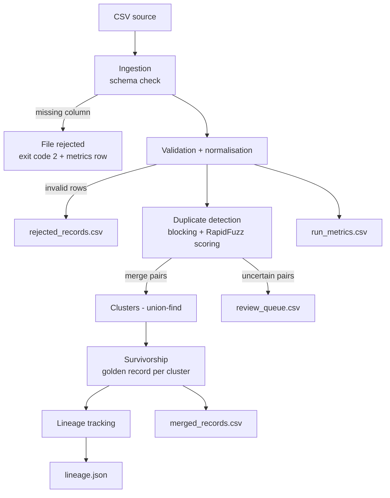

# Architecture

## Stages

| Stage | Module | Responsibility |
|---|---|---|
| Ingestion | `src/ingestion.py` | Read CSV as strings; reject file if required columns are missing; empty file => 0 records |
| Validation | `src/validation.py` | Trim/normalise; reject rows with missing name/email, bad email/phone, duplicate id |
| Detection | `src/duplicate_detection.py` | Blocking -> pair scoring -> union-find clustering -> review queue |
| Survivorship | `src/survivorship.py` | Merge each cluster into one golden record |
| Lineage | `src/lineage.py` | Record which source ids built each master, plus reasons and conflicts |
| Publish | `src/publish.py` | Atomic writes of all outputs; metrics upsert by `run_id` |

## Decision flow for a pair of records

1. Same email **and** phone -> merge (`exact_email_and_phone`)
2. Name similarity >= 90 and same email/phone -> merge (`similar_name_same_email|phone`)
3. Name similarity >= 75 with same email/phone, or >= 88 with nothing shared -> **review**
4. Otherwise -> no match

Only merge pairs create clusters. Review pairs never change the merged output; they are de-duplicated so a
reviewer sees at most one (best-scoring) pair per pair of clusters.

## Design choices

* **Blocking** keeps comparisons near-linear instead of quadratic.
* **Conservative auto-merge**: when unsure, send to humans rather than merge wrongly.
* **Deterministic everything** (sorted inputs, stable ids, content-hash run_id) => idempotent reruns.
* **Config as data**: thresholds in `MatchConfig`, overridable from the CLI.
