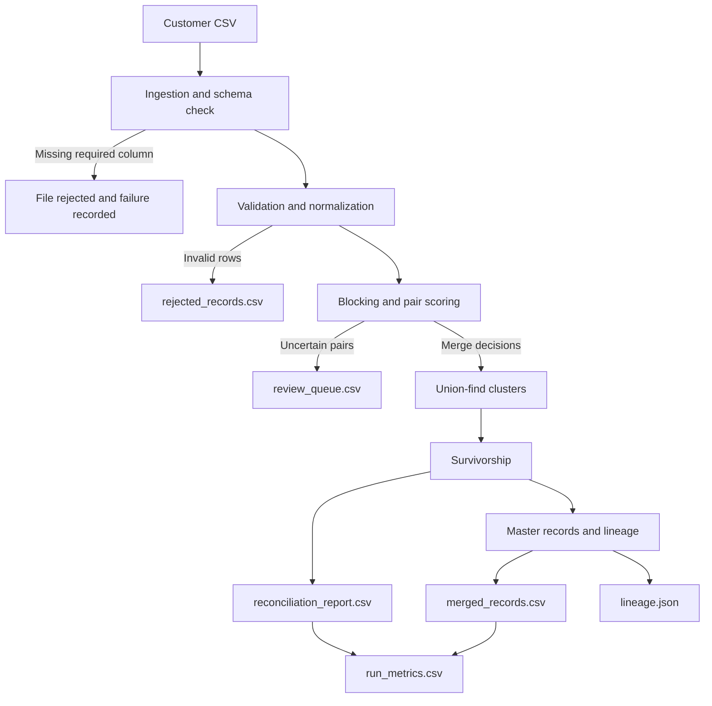

# Architecture

The pipeline is a local, single-file batch process. It reads a customer CSV, rejects invalid rows with
their reasons, groups likely duplicates, and writes the merged records and supporting reports to disk.
It does not need a database, cloud service, or model training.

## What each stage does

| Stage | Module | Responsibility |
|---|---|---|
| Ingestion | `src/ingestion.py` | Reads CSV values as strings, checks required columns, and records each source row number. |
| Validation | `src/validation.py` | Normalizes values and separates valid records from rejected rows with reasons. |
| Detection | `src/duplicate_detection.py` | Uses blocking to find candidate pairs, scores them, and groups approved matches. |
| Survivorship | `src/survivorship.py` | Chooses one value per field for each group of merged records. |
| Lineage | `src/lineage.py` | Records which source IDs contributed to each master record. |
| Reconciliation | `src/reconcile.py` | Checks row counts, source IDs, master IDs, rejects, and review-queue references. |
| Evaluation | `src/evaluate.py` | Optionally compares the output with labels produced separately by the synthetic-data generator. |
| Publishing | `src/publish.py` | Writes CSV and JSON outputs, replacing files atomically and updating run metrics. |
| Orchestration | `src/pipeline.py` | Runs the stages in order, logs timings, and records failures. |

## How a pair is handled

1. Records with the same email and phone are merged as an exact match.
2. Records with a name similarity of at least 90 and a shared email or phone are merged.
3. Similar records below the merge threshold (at least 75 with a shared identifier) go to review.
4. Similar names with no shared identifier (at least 88) also go to review.
5. Other pairs are left alone.

Only merge decisions join records into a cluster. Review suggestions do not change the merged output. If
multiple suggestions point to the same pair of clusters, the queue keeps the best-scoring suggestion.

The matcher compares records that share a phone, email, or name block instead of comparing every possible
pair. This reduces unnecessary comparisons while preserving identifier-based matches.

## Survivorship and identifiers

For each field, the pipeline ignores nulls and chooses the most common remaining value. If values tie, it
prefers the value from the most complete record, then the record with the lowest customer ID. Any fields
that disagreed are listed in `conflicting_fields`.

Master IDs are assigned deterministically from the sorted source IDs. The run ID is derived from the input
contents and matching configuration, so repeating the same run replaces its metrics entry.

## Failure and recovery

Each output file is written through a temporary file and then replaced atomically. The outputs are not
published as one transaction, so a process can fail after replacing some files. The pipeline writes metrics
last on success and records a failure reason when a run fails. Rerunning the same input to the same output
directory rebuilds the outputs; see the README for the operator steps.

This is a full-snapshot pipeline. It does not keep incremental history or apply late-arriving updates.

## Trade-offs

- Rule-based matching is easy to explain and test, but it may miss matches that a trained model could find.
- Conservative thresholds reduce risky merges but send more records to human review.
- Transitive clustering can merge a group through a chain of pairwise matches; a mistaken link can affect
  the whole group.
- The pipeline holds data in memory and is aimed at a 10,000-row run. Larger workloads may need distributed
  or database-side blocking.
